# Biblia RV1960 — PWA

Aplicación web progresiva (**sistema no nativo**) para consultar versículos y capítulos de la Biblia Reina-Valera 1960 con la API de [bolls.life](https://bolls.life). Funciona sin conexión, tiene modo presentación a pantalla completa y se instala en el teléfono o la computadora como una app independiente.

Materia: Tecnologías de desarrollo de software. Laboratorio "Biblia RV1960 PWA".

## Ejecutar

La app es HTML, CSS y JavaScript sin dependencias. Solo necesita un servidor local (no funciona abriendo el archivo con `file://`):

```bash
python3 -m http.server 8080
# abrir http://localhost:8080
```

Pruebas unitarias (Node 18 o superior):

```bash
node tests/lib.test.mjs
```

## Estructura

```
index.html              interfaz
styles.css              estilos (modo claro y oscuro)
manifest.webmanifest    nombre, íconos y capturas para instalar la app
sw.js                   Service Worker: shell con caché primero y API con stale-while-revalidate
js/books.js             66 libros con alias
js/lib.js               parser de referencias, limpieza de texto, formato
js/api.js               cliente de bolls.life
js/app.js               lógica de la interfaz, modo presentación e historial
tests/lib.test.mjs      pruebas unitarias
```

## Capturas

### Búsqueda con resultado

| Rango `1 Corintios 13:4-7` | `Juan 3:16` resaltado y centrado |
|---|---|
| 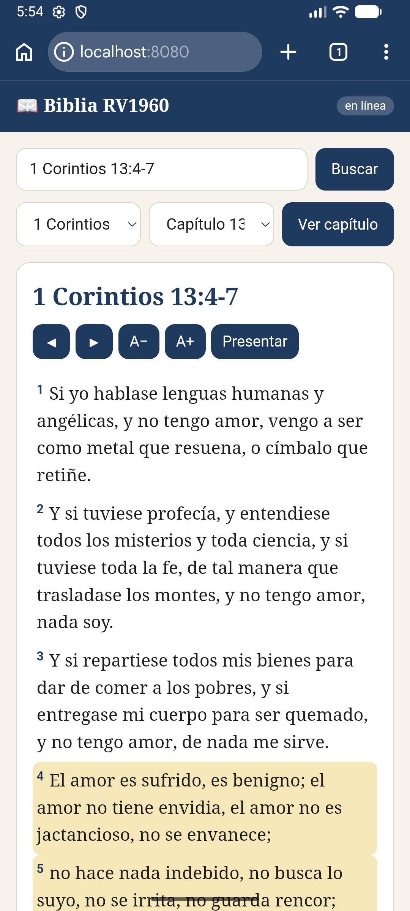 | 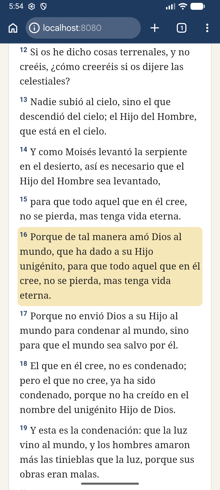 |

### Modo presentación y modo oscuro

| Presentación (pantalla completa) | Tema oscuro del sistema |
|---|---|
| 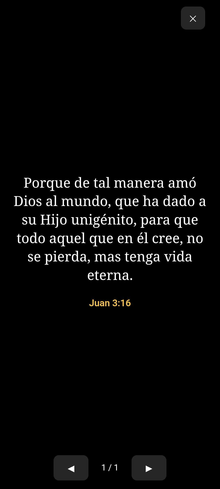 | 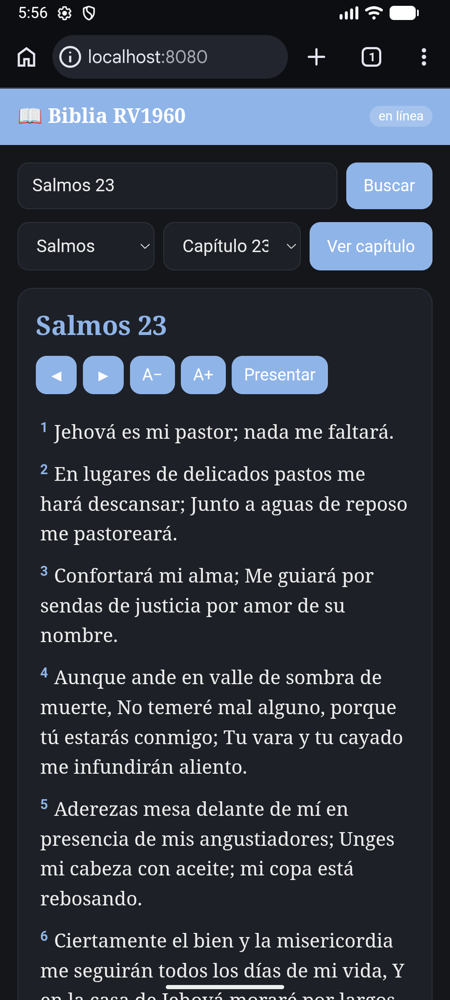 |

### Modo sin conexión

| Juan 3 (ya visitado) abre desde caché | Mateo 5 (no visitado) avisa sin romper la app |
|---|---|
| 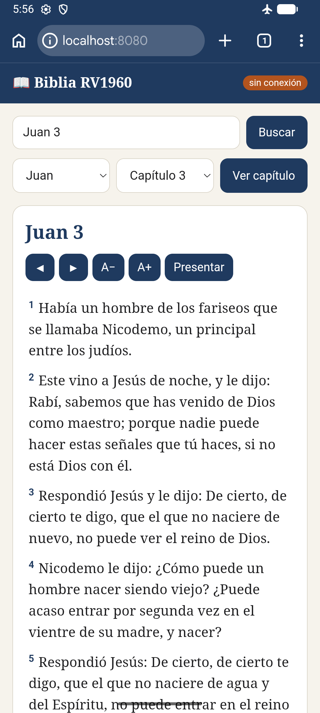 | 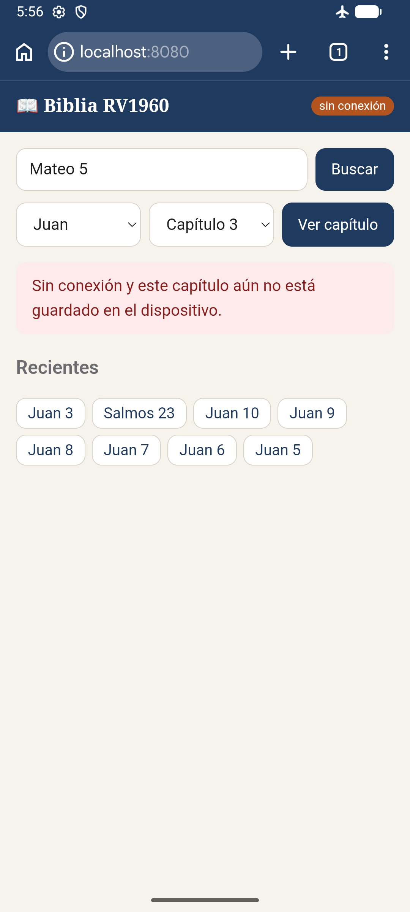 |

### App instalada (Android, Chrome)

| Instalar | Ícono en la pantalla de inicio | Abierta como app (sin barra del navegador) |
|---|---|---|
| 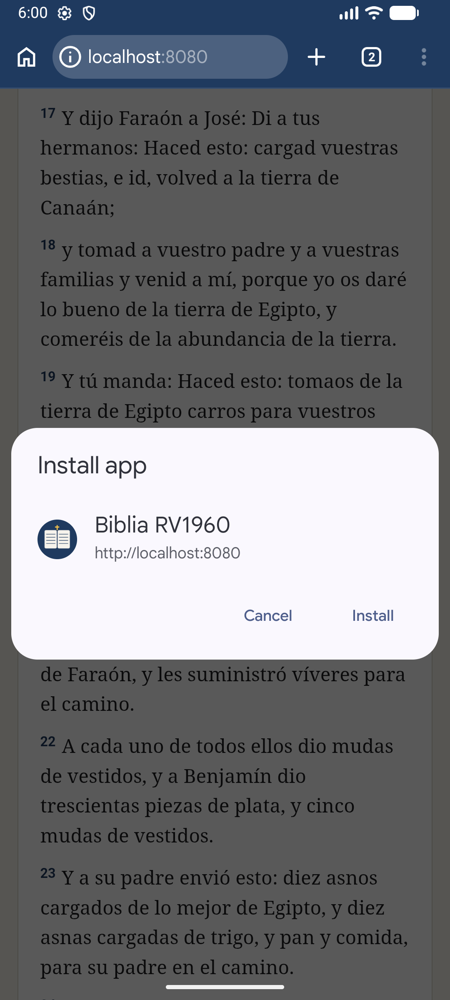 | 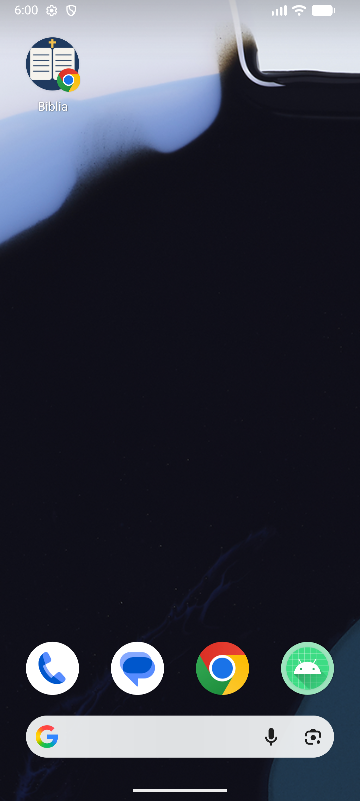 | 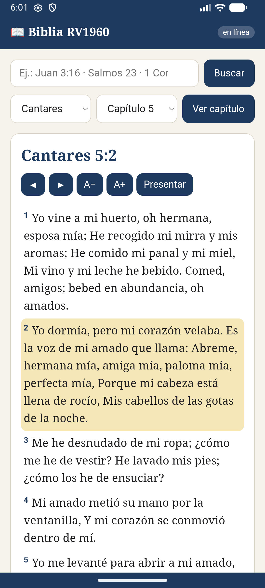 |

### DevTools → Application

**Manifest** sin errores ni advertencias:

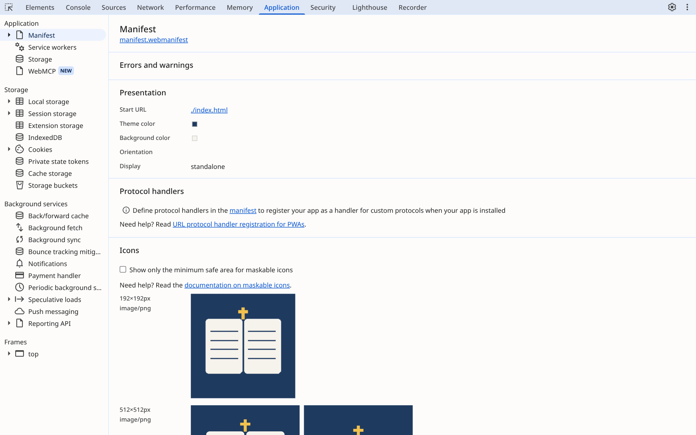

**Service Worker** activo ("activated and is running"):

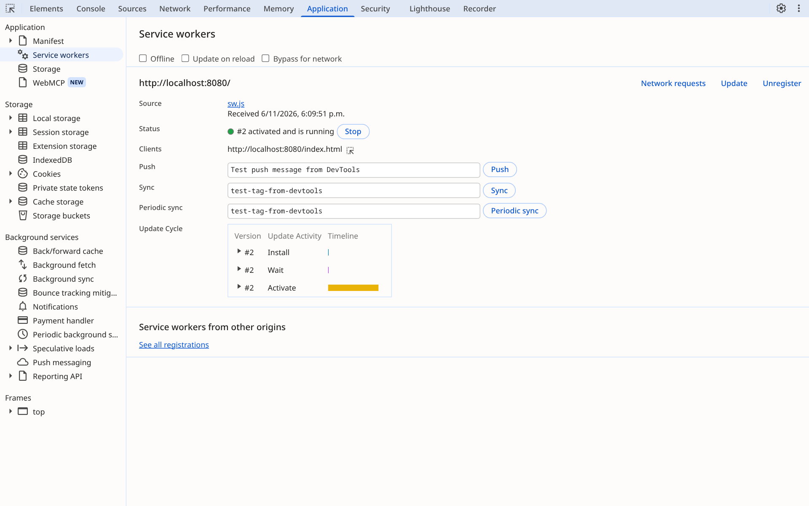

### Lighthouse (móvil)

| Performance | Accessibility | Best Practices | SEO |
|---|---|---|---|
| 100 | 100 | 100 | 100 |

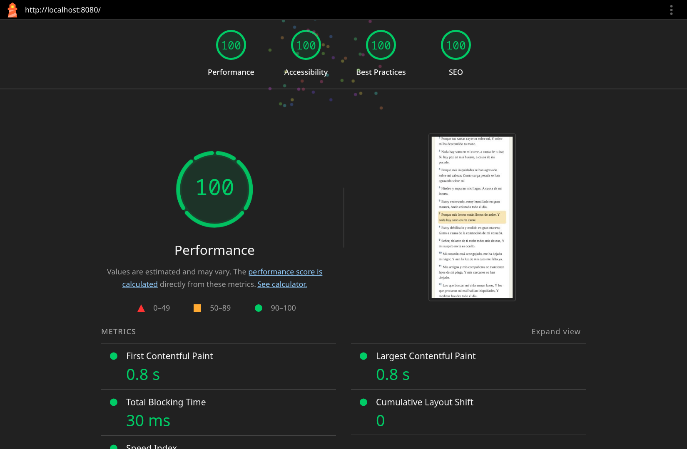

## Pruebas funcionales (7.1)

| # | Entrada / acción | Resultado esperado | OK | Observación |
|---|---|---|---|---|
| 1 | `Juan 3:16` | Juan 3 completo; versículo 16 resaltado y centrado | ✅ | |
| 2 | `jn 3` | Mismo capítulo sin resaltar | ✅ | |
| 3 | `1 Corintios 13:4-7` | Versículos 4 a 7 resaltados; título «1 Corintios 13:4-7» | ✅ | |
| 4 | `genesis 1` (sin acento) | Carga Génesis 1 | ✅ | |
| 5 | `Sal 23` | Carga Salmos 23 | ✅ | |
| 6 | `Apoc 22:21` | Resuelve «Apoc» como Apocalipsis | ✅ | |
| 7 | `Juan 22` | «Juan tiene 21 capítulos.» sin petición a la API | ✅ | |
| 8 | `Foo 3` | «No reconozco el libro «Foo».» | ✅ | |
| 9 | `Juan` (sin capítulo) | Mensaje con ejemplos de formato válido | ✅ | |
| 10 | Selectores: Salmos → 119 → Ver capítulo | Salmos 119 con 176 versículos | ✅ | |
| 11 | Génesis 50 → ▶ | Pasa a Éxodo 1 | ✅ | |
| 12 | Éxodo 1 → ◀ | Regresa a Génesis 50 | ✅ | |
| 13 | Apocalipsis 22 → ▶ | Se queda en Apocalipsis 22 | ✅ | Fallaba: saltaba a Apocalipsis 1. Se corrigió `step()` en `js/app.js` (también Génesis 1 → ◀) |
| 14 | Botones A+ / A− | Tamaño entre 0.8 y 2.2 rem | ✅ | |
| 15 | Clic en un versículo | Se resalta; segundo clic lo desmarca | ✅ | |
| 16 | Presentar con un versículo seleccionado | Pantalla completa solo con ese versículo y su referencia | ✅ | |
| 17 | Presentar sin selección; ← →, espacio y Esc | Navega todo el capítulo; Esc cierra y sale de pantalla completa | ✅ | |
| 18 | 10 consultas distintas | Historial con las 8 más recientes, sin repetidos | ✅ | |
| 19 | Tema del sistema en oscuro | La app cambia a colores oscuros | ✅ | |
| 20 | Modo avión tras leer Juan 3 | Juan 3 abre sin conexión; capítulo no visitado muestra aviso | ✅ | |

## Pruebas unitarias (7.2)

`node tests/lib.test.mjs` → **25 PASS**, «Todas pasaron». Son las 23 de la guía más 2 propias:

- `2 Pedro 1:3` → libro 61, capítulo 1, versículo 3.
- `  Rom   8:28  ` (espacios extras) → Romanos 8:28.

## Reto de ampliación ★★

**Versículo al azar al abrir la app.** Al iniciar con conexión, la app pide `get-random-verse/RV1960/` y abre ese capítulo con el versículo resaltado (se ve en la captura de la app instalada). No se guarda en el historial, y el Service Worker no lo cachea para que no salga siempre el mismo.
